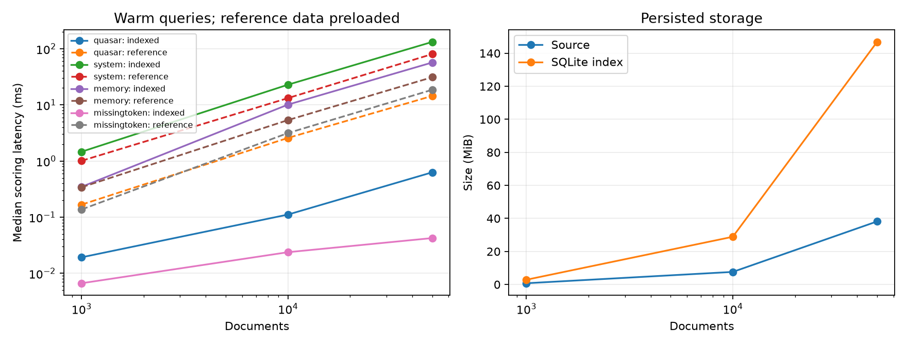

# IndexLite

A compact document search engine for studying indexing, ranking, storage, and
performance. IndexLite builds its own inverted index and implements BM25 in
Python. SQLite persists ordinary tables; no FTS, SQL text search, external search
engine, or online service is involved.

## Quick start

Requires Python 3.11 or later. The local verification environment uses Python
3.12.14. Activate a virtual environment before running these commands:

```sh
python -m venv .venv
# Windows PowerShell: .\.venv\Scripts\Activate.ps1
# Linux/macOS: source .venv/bin/activate
python -m pip install -e '.[dev,bench]'
indexlite build examples/demo --index artifacts/demo.sqlite3
indexlite search "recursive function stack" --index artifacts/demo.sqlite3 --top-k 3
```

The checked-in corpus contains eight original generated notes about programming
and computer systems. It contains no university lecture notes or third-party
course materials. Generate another deterministic copy with
`indexlite demo artifacts/demo-copy`; the destination must be empty.

Output from the checked-in demo:

```text
2 matching documents
1. algorithms/recursion.md | Recursive functions and the call stack | score=6.928327
   # Recursive functions and the call stack A recursive function calls itself on a smaller problem. Each function call pushes a stack frame containing arguments, local variables, and…
2. systems/memory.md | Stack and heap memory | score=3.577083
   # Stack and heap memory Stack memory usually follows function call lifetimes. A heap allocation can outlive the function that created it, so ownership and release need attention.…
```

## Commands

```sh
# Build or safely rebuild from a directory. Keep the database outside that directory.
indexlite build examples/demo --index artifacts/demo.sqlite3 --k1 1.2 --b 0.75

# Search, with optional settings overriding the stored defaults.
indexlite search "recursive function stack" --index artifacts/demo.sqlite3 --top-k 3
indexlite search "memory" --index artifacts/demo.sqlite3 --top-k 5 --k1 1.5 --b 0.5 --json

# Metadata and full storage/query verification.
indexlite stats --index artifacts/demo.sqlite3 --json
indexlite verify --index artifacts/demo.sqlite3 --query "stack" --query "missingtoken" --json

# Generate original sample notes in an empty directory.
indexlite demo artifacts/demo-copy --json

# Reproduce the performance experiment. Use a new output directory for each run.
indexlite benchmark --out artifacts/benchmark-new --sizes 1000 10000 50000 --seed 1729 --repetitions 20 --warmup 3 --top-k 10
```

Every command accepts `--json`. Search returns `query`, normalized `terms`,
`candidates`, ranked `hits` with ID/path/title/score/excerpt, and separate scoring
and formatting timings. Errors exit with code 2; with `--json`, stderr contains
an `error` object and stdout stays empty. Argparse usage errors retain its normal
text format. All commands are also available as `python -m indexlite`.

Text and Markdown input must be UTF-8. PDF extraction is optional:
`python -m pip install -e '.[pdf]'`. Install just the core with
`python -m pip install -e .`; it has no runtime dependencies beyond Python and
SQLite. Development and plotting extras are used by the tests and benchmark.
`requirements-dev.lock` records exact versions used by the local Python 3.12 run;
install it with `python -m pip install -r requirements-dev.lock` followed by
`python -m pip install -e . --no-build-isolation` for that environment.

Unsupported files and empty text documents are reported and skipped. Extraction
errors abort a rebuild and leave the previous index usable. `--skip-errors`
explicitly permits publishing an index with failed inputs omitted. Image-only
PDFs explain that OCR is outside version one. Source documents are never changed.

## How it works

The builder visits paths in deterministic order, applies a shared Unicode
tokenizer, counts term frequencies, and writes documents, terms, and postings
inside one transaction. Metadata records corpus statistics, tokenizer
configuration, schema version, and default ranking settings. A validated
temporary database replaces the destination only on success.

Search reads postings for unique query terms, scores the candidate union with
BM25, and selects top-k using a bounded heap. It fetches text only for the final
results. Scores descend; ties use ascending relative path. Query repetition
does not boost scores. NFKC normalization and case folding support Unicode;
punctuation and hyphens separate tokens. Numbers remain searchable. There is no
stemming, stop-word removal, phrase matching, or language-specific segmentation.

Read [the design](docs/design.md) for the schema, exact nonnegative-IDF BM25
formula, algorithm costs, transaction boundaries, and Windows publication
behaviour. Close readers before rebuilding on Windows; an open reader can block
replacement and will produce a clear error. Rebuilds must be serialized by the
caller.

## Verification

```sh
python -m pytest
python -m ruff check .
python -m ruff format --check .
```

Tests cover independently calculated scores and postings, hand-designed
rankings, Unicode, empty input, heap/full-sort agreement, exhaustive/indexed
agreement, separate CLI processes, generated PDF extraction, corrupted storage,
changed/removed inputs, failed rebuilds, and open readers in another process.
Local verification: **67 tests passed**, with Ruff lint and format checks passing
on Python 3.12.14 / Windows 11. The GitHub Actions matrix is configured for Python
3.11–3.14 on Linux and Windows; that remote matrix has not been run locally.

## Performance experiments

The benchmark generates distinct synthetic documents with varying lengths and
known rare/common term frequencies. It checks ordered IDs, scores, and candidate
counts against an exhaustive implementation before accepting timings. The
reference preloads token-frequency dictionaries; its loading is measured
separately. The query mix includes common terms and absent terms, and the small
demo corpus is measured separately.

Reports include total build time and throughput, extraction/tokenization/storage
boundaries, source/index size, median/p95 latency, candidates, agreement,
first-query measurements, and warm-query speedup or slowdown. Scoring and
snippet formatting have separate timers. Cache conditions are uncontrolled;
no measurements claim a cold cache or total RAM usage.

Measured on 13 October 2026 with seed 1729, 20 repetitions, three warm-up passes,
and top-k 10. All **30 query cases and 600 warm samples agreed** with the exhaustive
reference. Builds on this Windows environment were dominated by file extraction:

| Documents | Build seconds | Documents/s | Source MiB | Index MiB |
|---:|---:|---:|---:|---:|
| 1,000 | 12.872 | 77.69 | 0.76 | 2.87 |
| 10,000 | 129.570 | 77.18 | 7.61 | 28.89 |
| 50,000 | 689.640 | 72.50 | 38.17 | 146.86 |

Selected warm results for 50,000 synthetic documents:

| Query | Candidates | Indexed median/p95 ms | Reference median ms | Scoring speedup |
|---|---:|---:|---:|---:|
| `quasar` | 50 | 0.6291 / 0.8063 | 14.4441 | 22.96× |
| `system` | 50,000 | 132.3952 / 141.8097 | 80.4172 | 0.61× |
| `memory` | 10,000 | 56.8940 / 61.3293 | 31.1227 | 0.55× |
| `term000 term001` | 25,277 | 133.6974 / 143.8425 | 64.1088 | 0.48× |

Selective postings help; common and mixed terms can be slower than scanning
preloaded dictionaries. On the eight-note demo, fixed index overhead made every
measured query slower than the preloaded reference. The absent-term synthetic
case is particularly favourable and appears in the full report, not as a general
speedup claim. The reference's 50,000-document preload took 2.354 seconds and is
excluded from these scoring ratios. Snippet costs are also excluded and reported
separately. These are machine-specific measurements, not relevance evaluation
or production traffic.

Read [the methodology](docs/benchmarks.md), [the measured report](docs/results/2026-10-13/report.md),
and [aggregate JSON](docs/results/2026-10-13/summary.json). The 1,000-document case
was measured in a separate run with identical settings. Raw CSV/JSON, generated
corpora, and databases remain under ignored `artifacts/`; the checked-in JSON
includes the raw CSV checksum.



## Limits and source tour

Version one supports complete rebuilds and one writer. It stores extracted text
as well as postings, so the database can be considerably larger than the corpus.
Common terms can make all documents candidates, and Python/SQLite overhead can
make that path slower than scanning preloaded dictionaries. Search agreement
does not establish relevance on real lecture notes or user traffic.

There is no OCR, incremental indexing, positional/phrase search, compression,
web interface, server, embeddings, or distributed execution. Useful extensions
are content-hash updates, positional postings, and compression after separate
correctness and performance work.

Start with these files:

| File | What to study |
|---|---|
| `src/indexlite/tokenizer.py` | Shared Unicode normalization and unique query terms |
| `src/indexlite/builder.py` | Term IDs, frequencies, transactions, and safe publication |
| `src/indexlite/storage.py` | SQLite schema, read snapshots, and invariant validation |
| `src/indexlite/ranking.py` | BM25 contributions and bounded heap ordering |
| `src/indexlite/search.py` | Posting-based candidate scoring and result formatting |
| `src/indexlite/reference.py` | Exhaustive comparison and verification |
| `src/indexlite/benchmark.py` | Timing boundaries, agreement checks, raw data, and plots |
| `tests/test_engine.py` | Independent small examples and ranking expectations |

MIT licensed.
